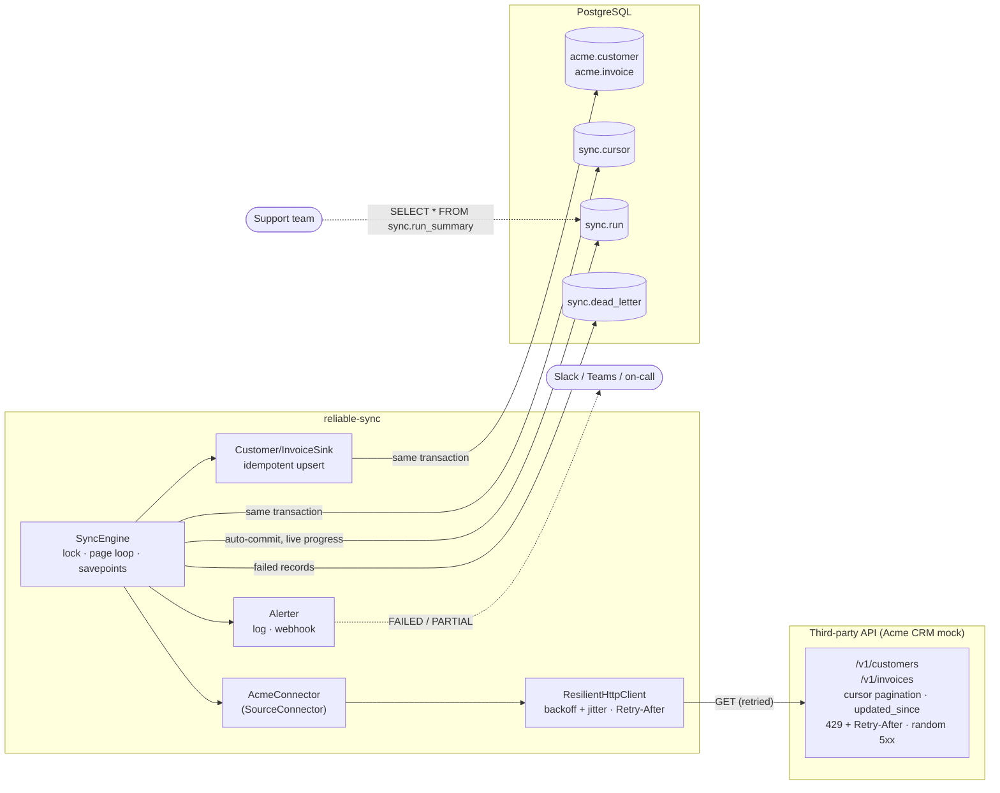
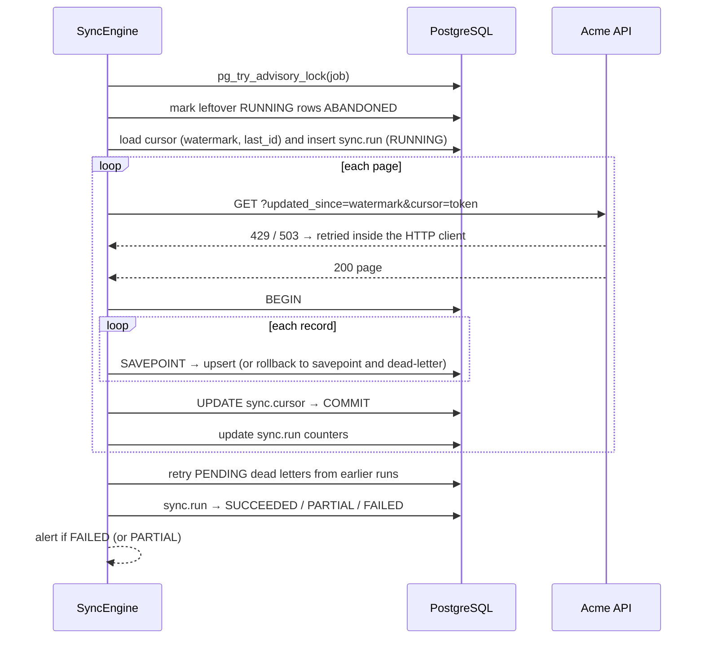

# reliable-sync

[](https://github.com/Abdullah204/reliable-sync/actions/workflows/ci.yml)


A reference integration showing how I build **reliable data syncs**.

> **reliable-sync** incrementally copies customers and invoices from a third-party REST API
> ("Acme CRM", a deliberately unreliable mock) into PostgreSQL. It survives crashes, rate limits,
> flaky servers and bad records without losing or duplicating data, and every run is visible to
> a support team.

```bash
docker compose up      # that's it: Postgres + fake CRM + sync service (images from GHCR)
```

The generic engine (cursor store, retries, dead letters, run log, alerting) comes from
`connector-foundations`, my private library that every connector I build depends on. This repo
holds the connector, the database schema, the fault-injecting mock and the end-to-end tests that
prove the behaviour described below.

---

## The problem it solves

Most "sync data from SaaS X into our database" scripts work in the demo and fail in production:

| What goes wrong in production | Typical symptom | How reliable-sync handles it |
|---|---|---|
| The script crashes halfway (deploy, OOM, kill) | Next run starts over, or worse, skips data | Cursor committed **atomically with each page**, so it resumes exactly where it stopped |
| The job runs twice, or a page is re-read | Duplicate invoices in reports | **Idempotent upserts** keyed on the vendor's ID; re-running changes nothing |
| API returns `429 Too Many Requests` | Job dies, or hammers the API and gets banned | **Honors `Retry-After`**, otherwise exponential backoff with jitter |
| API has a bad minute (`502`, `503`) | Whole night's sync lost | Transient errors **retried**; only persistent failure fails the run |
| One record has garbage data | One bad invoice blocks 10,000 good ones | Bad record goes to a **dead-letter table**; the rest of the page lands |
| Nobody notices it stopped | Discovered weeks later by finance | **`sync.run` log** for support, plus **alerts** (log + Slack/Teams webhook) |
| Two schedulers overlap | Race conditions on the cursor | **Advisory lock**: one writer per object type |

## Architecture



### One run, step by step



## How each reliability feature works

### 1. Incremental sync with a crash-safe cursor
The cursor is `(watermark, last_external_id)`: the `updated_at` and ID of the last record
committed. It is written **in the same database transaction** as the page of records it covers
(`SyncEngine.applyPage` in the engine).
After a crash, the cursor can never point past data that wasn't saved, and no committed data
sits behind a cursor that was lost.

Two details that simple implementations miss:
* **Timestamp ties.** Many records can share one `updated_at`. The API filter is inclusive
  (`>=`), so the boundary records come back again, and the engine skips the ones whose
  `(updated_at, id)` is ≤ the cursor (`Cursor.hasAlreadyCommitted`).
  A test crashes the job after *every* page to prove nothing is lost or doubled at the boundaries.
* **Page tokens are never persisted.** Vendors expire them and they become invalid when data
  changes. Only the timestamp watermark is durable.

A process that dies leaves its `sync.run` row as `RUNNING`. The next run (holding the lock, so
no live process can own that row) marks it `ABANDONED`, which tells support what happened.

### 2. Idempotent upserts
```sql
INSERT INTO acme.invoice (...) VALUES (...)
ON CONFLICT (external_id) DO UPDATE SET ...
 WHERE acme.invoice.content_hash IS DISTINCT FROM EXCLUDED.content_hash   -- skip no-op writes
   AND acme.invoice.source_updated_at <= EXCLUDED.source_updated_at       -- never go back in time
RETURNING (xmax = 0)                                                      -- true = inserted
```
* `external_id UNIQUE` makes duplicates impossible at the database level, not just in code.
* The content hash separates **updated** from **unchanged**, so run statistics mean something.
* The stale-write guard means a late replay (say, from the dead-letter queue) can never
  overwrite newer data.
* The full payload is kept in `raw jsonb`, so new columns can be backfilled without re-calling the API.

### 3. Retry with exponential backoff and jitter, honoring Retry-After
`ResilientHttpClient` and `RetryPolicy`, used by
[`AcmeApiClient`](services/reliable-sync/src/main/java/io/github/abdullah204/reliablesync/acme/AcmeApiClient.java):

| Response | Action |
|---|---|
| 2xx | return |
| 408, 429, 500, 502, 503, 504, I/O error | retry |
| any other 4xx | fail immediately (retrying can't fix a 401 or 404) |

The delay before retry *n* is `random(0, min(maxDelay, base × 2ⁿ⁻¹))`. This is "full jitter",
which keeps many clients from retrying in lockstep. If the server sends `Retry-After` (seconds
or an HTTP date), **that value is used instead**, capped so a bad header can't stall the job for
hours. Time is injected through a `Sleeper`, so tests check the exact delays without waiting.

### 4. Dead-letter table
Each record is applied under a **savepoint**. If the sink rejects it (invalid currency, negative
amount, a constraint violation), only that record is rolled back. It is stored in
`sync.dead_letter` with its full payload and error, and the rest of the page commits.

```
PENDING ──(retried automatically on each later run)──▶ RESOLVED
   │
   └──(max attempts reached)──▶ PARKED  (waits for a human; still resolves
                                         if the source sends a fixed version)
```
A partial unique index allows **one open dead letter per record**, so repeated failures increment
`attempts` instead of piling up rows. Database *outages* (SQLState 08/53/57/40) are not
dead-lettered. They fail the run, because hiding an outage as 10,000 "bad records" would be worse.

### 5. `sync_runs` log a support team can read
Every run is a row in `sync.run`. It is written on separate auto-commit connections, so it
shows live progress and still records failures after the data transaction has rolled back.
Two views give support a plain-language answer:

```sql
SELECT * FROM sync.run_summary ORDER BY run_id DESC LIMIT 20;
SELECT * FROM sync.dead_letter_open;
```
Status meanings are stored as column comments in the database itself (`\d+ sync.run`).

### 6. Alerting
`FAILED` runs raise an **ERROR** alert and `PARTIAL` runs a **WARNING**. Alerts always go to a
dedicated `ALERT` logger, and optionally to a webhook. The payload's `text` field works unchanged
with Slack and Microsoft Teams incoming webhooks, and the structured fields serve anything else.
An alerter can never throw into the sync: a broken Slack integration must not stop the data.

```bash
ALERT_WEBHOOK_URL=https://hooks.slack.com/services/... docker compose up
```

## Quickstart

Requires only Docker. No local JDK or Gradle is needed.

```bash
./scripts/demo.sh
```
This pulls the published images and starts PostgreSQL, the fake CRM (5% random 5xx, 10 req/s limit, some invalid
invoices, records edited every 20 s) and the sync service (runs every 15 s), then prints the
support report. Other scripts:

```bash
./scripts/report.sh                         # recent runs + open dead letters
./scripts/psql.sh                           # poke around acme.* and sync.*
docker compose logs -f reliable-sync        # watch retries and dead letters live
docker compose down -v                      # clean up
```

## Sample `sync_runs` output

Real output of `./scripts/report.sh` after about a minute of `./scripts/demo.sh`. Run 2 is the first
invoice load: 15 invalid invoices went to the dead-letter table and the other 585 landed. Later runs
are incremental and only pick up what the mock changed. The dead letters were retried on each run
and `PARKED` after 3 attempts.

```
Recent sync runs
 run_id | source   | object_type | status    | fetched | inserted | updated | unchanged | dead_lettered
--------+----------+-------------+-----------+---------+----------+---------+-----------+--------------
 8      | acme-crm | invoice     | SUCCEEDED | 2       | 1        | 0       | 1         | 0
 7      | acme-crm | customer    | SUCCEEDED | 8       | 1        | 3       | 4         | 0
 6      | acme-crm | invoice     | SUCCEEDED | 3       | 1        | 0       | 2         | 0
 5      | acme-crm | customer    | SUCCEEDED | 5       | 1        | 3       | 1         | 0
 4      | acme-crm | invoice     | SUCCEEDED | 2       | 0        | 0       | 2         | 0
 3      | acme-crm | customer    | SUCCEEDED | 1       | 0        | 0       | 1         | 0
 2      | acme-crm | invoice     | PARTIAL   | 600     | 585      | 0       | 0         | 15
 1      | acme-crm | customer    | SUCCEEDED | 250     | 250      | 0       | 0         | 0

Open dead letters
 id | object_type | external_id | status | attempts | error
----+-------------+-------------+--------+----------+------------------------------------------------------------------
 1  | invoice     | inv_000040  | PARKED | 3        | invoice inv_000040 has unknown currency '???' (expected ISO 4217)
 2  | invoice     | inv_000080  | PARKED | 3        | invoice inv_000080 has unknown currency '???' (expected ISO 4217)
 …  (15 rows)
```

Meanwhile, in the service log:

```
WARN  ALERT - [WARNING] acme-crm/invoice run #2: 15 record(s) dead-lettered | See: SELECT * FROM sync.dead_letter_open WHERE ...
WARN  ResilientHttpClient - GET http://acme-crm-mock:8081/v1/customers?limit=100&updated_since=... failed (HTTP 503); retry 1/5 in 2 ms
WARN  ResilientHttpClient - GET http://acme-crm-mock:8081/v1/customers?limit=100&updated_since=... failed (HTTP 500); retry 1/5 in 389 ms
```
(Columns `started_utc`, `duration`, `recovered` and `error` are trimmed here for width.)

## How I'd apply this to QuickBooks / NetSuite / HubSpot

The engine doesn't know about Acme. A new source needs one `SourceConnector` per object type
(fetch a page since a timestamp) and one `RecordSink` (idempotent upsert). Cursor, retries,
dead letters, run log, alerting and locking come for free. Each real API has its own quirks:

**QuickBooks Online**
* *Incremental:* the `CDC` endpoint (`/cdc?entities=Invoice,Customer&changedSince=`) returns
  changes, including deletes, for up to 30 days. Use it as the connector and fall back to a full
  query `WHERE MetaData.LastUpdatedTime > '…'` when the cursor is older than 30 days.
* *Pagination:* `STARTPOSITION` / `MAXRESULTS` (1000) in the query language. Like here, only the
  timestamp is persisted.
* *Limits:* about 500 requests/min per realm, with 429 responses. `RetryPolicy` already covers it.
  Run one job per company (realm), so the advisory lock is keyed by realm.
* *Auth:* OAuth 2 with refresh tokens that rotate on every use. Store the new refresh token
  **transactionally**, or a crash at the wrong moment locks you out.
* *Gotchas:* soft deletes come as `status: Deleted` in CDC, so add an `is_deleted` column rather
  than deleting rows. `SyncToken` gives optimistic locking for any write-back.

**NetSuite**
* *Incremental:* SuiteQL over REST (`POST /query/v1/suiteql`) with
  `WHERE lastModifiedDate >= TO_DATE(...) ORDER BY lastModifiedDate, id`. That's the same
  `(timestamp, id)` cursor this engine uses. Saved searches over RESTlets are the fallback for
  record types SuiteQL can't reach.
* *Pagination:* `limit`/`offset` (max 1000). Offsets shift when data changes mid-run, which is
  exactly why the cursor holds a watermark and not a page token.
* *Limits:* account-wide concurrency limits are shared with every other integration. Use a
  small worker pool, treat `429` and `SSS_REQUEST_LIMIT_EXCEEDED` as retryable, and back off hard.
* *Auth:* token-based auth (OAuth 1.0a TBA) or OAuth 2 machine-to-machine; requests are signed
  per call.
* *Gotchas:* `lastModifiedDate` is in the account's time zone, so normalize to UTC before
  comparing. Custom fields (`custbody_*`) vary per customer, so keep them in `raw jsonb` and
  map them through configuration.

**HubSpot**
* *Incremental:* CRM Search API (`POST /crm/v3/objects/contacts/search`) filtered and sorted on
  `hs_lastmodifieddate`. The search endpoint caps results at 10,000 per query, so when a window
  fills up, the connector narrows the time window and re-queries. That fits the cursor model directly.
* *Pagination:* `after` cursor tokens; never persisted, as here.
* *Limits:* per-app burst limits (for example 100–190 requests/10 s) with `429` and `Retry-After`,
  plus a lower limit on search. Run with a separate `RetryPolicy` per endpoint family.
* *Gotchas:* merged records change ID (keep a `merged_into` mapping), and associations
  (contact↔company↔deal) are a separate object type with its own job and cursor. Webhooks can
  trigger a run early, but polling stays the source of truth because webhooks are not guaranteed.

In all three cases, `sync.run`, `sync.dead_letter` and the alerts stay exactly as they are, so
the support team learns one set of tables for every integration.

## Repository layout

```
build-logic/            Gradle convention plugin (Java 21 toolchain, -Werror, JUnit 5)
mocks/acme-crm-mock/    Fake CRM API with pagination, rate limiting and fault injection
services/reliable-sync/ Acme connector, sinks, acme schema migration, CLI, end-to-end tests
scripts/                demo.sh, report.sh, psql.sh, build-images.sh
```

From `connector-foundations` (private, GitHub Packages): `foundations-sync` (engine, stores,
alerting, `sync` schema), `foundations-http` (resilient client), `foundations-jdbc` (pool,
migrations, transactions) and `foundations-testing` (Testcontainers fixture).

## Tests

```bash
./gradlew build    # needs Docker for Testcontainers, plus access to connector-foundations
```
Building from source needs the private engine: either a checkout at `../connector-foundations`
or `PACKAGES_TOKEN` set to a GitHub token that can read its package. CI runs the full suite on
every push.

| Suite | Proves |
|---|---|
| `IdempotentUpsertTest` | full re-sync writes nothing new; incremental picks up only changes; stale versions never win |
| `ResumeAfterCrashTest` | simulated process death resumes from the committed cursor; ABANDONED marking; tie-safe at every page boundary |
| `RetryAndRateLimitTest` | exact Retry-After honored on 429; bounded backoff on 5xx; real rate limit survived; exhausted retries → FAILED + ERROR alert |
| `DeadLetterTest` | bad records isolated, retried, parked at max attempts, resolved when fixed upstream |

The engine's own unit tests (retry policy, Retry-After parsing, cursor ties, auth, webhook payloads)
live with it in `connector-foundations`.

Integration tests run against a **real PostgreSQL** in Testcontainers (no H2) and the **real HTTP
mock**. The only fakes are the clock-free sleeper and the captured alerter.

## Design decisions

* **Plain Java + JDBC, no framework.** The SQL is the important part (upserts, savepoints,
  advisory locks), so it stays visible. It drops into Spring, Quarkus or a Lambda unchanged.
* **Polling over webhooks as the source of truth.** Webhooks are a good trigger but not a
  guarantee. The cursor-based poll is what makes the sync correct.
* **No foreign keys between synced objects.** Object types sync independently, so an invoice
  may arrive before its customer. Integrity checks belong downstream.
* **The schema per concern is versioned separately.** `sync.*` (the engine) and `acme.*` (the
  connector) each have their own Flyway history.

## License

MIT
